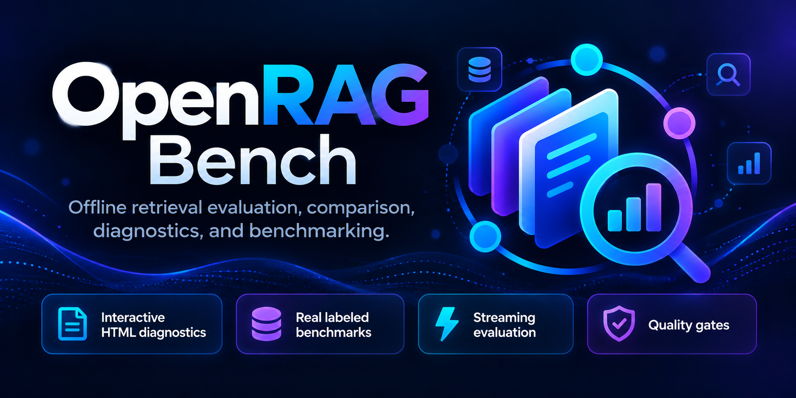
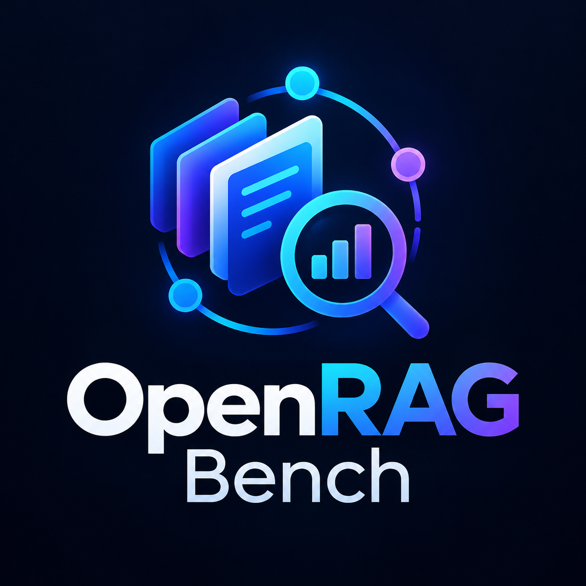

<p align="center">
  
</p>

<p align="center">
  
</p>

<h1 align="center">OpenRAG Bench</h1>

<p align="center">
  <strong>Measure · Compare · Diagnose · Improve</strong>
</p>

<p align="center">
  <a href="https://github.com/ilker-Akbal/openrag-bench/actions/workflows/ci.yml"></a>
  <a href="LICENSE"></a>
  <a href="pyproject.toml"></a>
  <a href="https://github.com/ilker-Akbal/openrag-bench/releases/tag/v0.4.0"></a>
</p>

**Offline retrieval evaluation and regression testing for RAG pipelines.**

OpenRAG Bench is a small Python toolkit for comparing the ranked document results of retrieval-augmented generation systems. It helps developers catch regressions when they change an embedding model, chunking strategy, retriever or index configuration.

- **Measure** Precision@k, Recall@k, Hit@k, MRR@k, MAP@k, binary and graded NDCG@k.
- **Compare** candidate and baseline outputs, aligned by stable query identifiers.
- **Guard** a CI pipeline with an explicit minimum metric delta and exit code 2.
- **Report** macro-averaged results, per-query metrics and HTML, JSON or spreadsheet-safe CSV output.
- **Integrate** custom, LangChain, LlamaIndex and optional FAISS retrievers using stable document IDs.
- **Reproduce** seeded, paired-bootstrap uncertainty intervals without a cloud API.

**Status:** [v0.4.0 public GitHub pre-release](https://github.com/ilker-Akbal/openrag-bench/releases/tag/v0.4.0), with SHA-256 checksums and tested wheel/source archives. This measures **retrieval relevance**, not LLM answer quality or factual correctness. The bundled quickstart fixtures are synthetic; separate, real **SciFact** benchmark results are independently verified and published below. We do not claim benchmark superiority or an established external user base.

**Language:** English documentation (primary) · [Türkçe hızlı başlangıç](docs/README_TR.md)

## OpenRAG Guard — block critical retrieval regressions (v0.4.0)

OpenRAG Guard checks **scoped retrieval quality policies**. It can block
an update when the overall NDCG improves but a critical privacy question
loses its relevant document.

~~~bash
openrag-bench init --directory openrag-demo
openrag-bench doctor openrag-demo/candidate.json --baseline openrag-demo/baseline.json --policy openrag-demo/guard-policy.json --k 1
openrag-bench guard openrag-demo/candidate.json --baseline openrag-demo/baseline.json --policy openrag-demo/guard-policy.json --k 1 --html guard.html
~~~

Try candidate-regression.json instead of candidate.json to see the same
overall improvement correctly **blocked** (exit status 2). All demo inputs
are original synthetic text. See the [OpenRAG Guard policy and Action guide](docs/GUARD.md).
This release includes the Guard commands directly in the installable wheel.

## Quick start

Requires Python 3.10 or newer. Install the **GitHub release wheel** (not published on PyPI):

```bash
python -m pip install https://github.com/ilker-Akbal/openrag-bench/releases/download/v0.4.0/openrag_bench-0.4.0-py3-none-any.whl
openrag-bench --help
```

To run the examples and tests from source:

```bash
git clone https://github.com/ilker-Akbal/openrag-bench.git
cd openrag-bench
python -m pip install -e .
python -m unittest discover -s tests -v
openrag-bench examples/retrieval_results.json --k 2 --output report.json --html report.html
```

## Offline diagnostic explorer (v0.4.0)

Standalone interactive HTML reports show per-query worst regressions, judgment coverage, empty retrieval cases, top-k overlap, and local metric filtering. Reports contain query IDs, **not raw question text or document IDs**.

They use no external scripts or trackers.

The latest source checkout on `main` includes a refreshed report-first
dashboard: an immediately visible **release decision**, critical-query
before/after ranking evidence, plain-English rule failures, query filtering,
and collapsed technical metrics. The already published v0.4.0 wheel retains
the original explorer layout until a subsequent reviewed release.

A more diverse, original six-query demo at `k=3` helps distinguish metrics:

~~~bash
openrag-bench guard examples/report_diverse_candidate.json --baseline examples/report_diverse_baseline.json --policy examples/guard_policy.json --k 3 --html report_diverse.html
~~~

This scenario has multiple positive documents and differing rankings; it
does not represent an independent production benchmark.

~~~bash
openrag-bench examples/comparison_candidate.json --baseline examples/comparison_baseline.json --k 2 --html diagnostics.html
~~~

## JSONL input and CSV diagnostics

Use newline-delimited retrieval records directly and export spreadsheet-safe, query-level metric comparisons:

```bash
openrag-bench examples/retrieval_results.json --csv per_query.csv --k 2
openrag-bench candidate.jsonl --baseline baseline.jsonl --csv deltas.csv --k 5
```

CSV reports exclude raw question text and protect against spreadsheet formula injection. See [data formats](docs/USAGE.md).

## Bounded-memory JSONL summary mode

For large labeled JSONL datasets, evaluate without materializing the complete input or per-query report:

~~~bash
openrag-bench large.jsonl --streaming-summary --k 5 --output summary.json
~~~

This mode writes only aggregate metrics and rejects baselines, HTML, CSV and TREC inputs. Normal JSONL/JSON/TREC behavior remains unchanged. See the [streaming guide](docs/USAGE.md) and [100k-query synthetic benchmark evidence](benchmarks/streaming_100k_2026-10-13.json).

On one Python 3.11 GitHub runner, Python peak allocations were 0.302 MiB streaming versus 121.297 MiB batch, while streaming took 12.46 s versus 9.42 s batch. This is a **memory-for-speed tradeoff**, not a production throughput or total system RAM claim.

## Graded judgments and MAP@k

Beyond binary relevance, evaluate documents labeled with positive integer relevance grades, including standard graded TREC qrels:

```bash
openrag-bench examples/trec_candidate.run --qrels examples/trec_graded.qrels \
  --graded-qrels --k 2 --metric graded_ndcg_at_k
```

The original binary NDCG definition remains unchanged. See [metric definitions and graded JSON input](docs/USAGE.md).

## Compare two retrieval versions

```bash
openrag-bench examples/comparison_candidate.json \
  --baseline examples/comparison_baseline.json \
  --k 2 --metric ndcg_at_k --min-delta 0 \
  --output comparison.json --html comparison.html
```

A negative delta means the candidate scored worse than the baseline. With `--min-delta 0`, the CLI exits with code `2` if that metric regresses. Use this as a deterministic engineering gate, **not** as a statistical significance test.

## Evaluate standard TREC run files

No custom JSON conversion needed for common information-retrieval datasets.

Given four-column `qrels` and six-column `run` files:

```bash
openrag-bench examples/trec_candidate.run \
  --qrels examples/trec.qrels \
  --baseline examples/trec_baseline.run \
  --k 2 --metric ndcg_at_k --min-delta 0
```

Each query from the qrels contributes to the score even when the run returns nothing. Positive relevance grades count as relevant; zero and negative judgments are not relevant. Unknown query IDs, duplicate docs, duplicate ranks and invalid scores are rejected.

## Run against a real retriever

```python
from openrag_bench.adapters import run_retriever

class Retriever:
    def retrieve(self, query: str, k: int):
        return ["doc-1", "doc-2"][:k]

result = run_retriever(
    Retriever(),
    [{"query_id": "q1", "question": "What is RAG?", "relevant_ids": ["doc-2"]}],
    k=2,
)
print(result["metrics"])
```

An optional FAISS adapter and reproducible synthetic-vector example are provided:

```bash
python -m pip install '.[faiss]'
python examples/faiss_integration.py
```

## Turkish human-labeled retrieval evaluation (v0.4.0)

A dedicated offline Python evaluator measures BM25 under Unicode casefolding versus Turkish-specific dotted/dotless-I casing on an **external** dataset of 54 Turkish Wikipedia articles and **58 human-annotated Turkish questions**.

The corpus is CC BY-SA 4.0 and **is downloaded at test time only**, not redistributed with our MIT package. No third-party question/article content is written to published GitHub reports.

~~~bash
python examples/turkish_real_benchmark.py --download --k 10 --output turkish_summary.json
~~~

See [provenance, exact pinned revision, data limitations and results](docs/TURKISH_BENCHMARK.md).

These are article-level lexical retrieval baselines on a single health-domain set, not multilingual model certification.

## Reproduce a real dataset benchmark

Run two lexical retrieval baselines against the externally hosted **BEIR SciFact test** split (5,183 scientific abstracts; 300 judged queries):

```bash
python examples/scifact_benchmark.py --download --k 10 --output-dir reports/scifact
```

The tool explicitly downloads the official 2.8 MB ZIP, verifies the checksum, reads it without extracting files, builds a local inverted index, runs **TF-IDF cosine** and **BM25**, and saves ranked TREC run files plus aggregate and per-query comparisons. Python standard library is sufficient.

**Verified results are published:** BM25 NDCG@10 **0.6605**, versus TF-IDF **0.6329** on 300 judged queries. See the exact [reproduction, data attribution and limitations](docs/BENCHMARK_SCIFACT.md) and [aggregate-only metrics](benchmarks/scifact_2026-10-13.json). The dataset retains its respective licenses; no data is included in this code repository.

## Use existing LangChain or LlamaIndex retrievers

Plug in LangChain `invoke(query)` retrievers or LlamaIndex `retrieve(query)` retrievers without installing those frameworks as mandatory package dependencies. Both adapters extract stable document/node IDs and reject duplicates.

See the [framework integration guide](docs/FRAMEWORK_INTEGRATIONS.md).

In addition to offline contract mocks, an [optional actual-framework vector-store test](examples/framework_real_integration.py) uses LangChain InMemoryVectorStore and LlamaIndex VectorStoreIndex with original synthetic keyword embeddings. The [dedicated integration workflow](.github/workflows/framework-real-integration.yml) checks specific pinned framework versions; this is not a semantic quality benchmark or proof of compatibility across all releases.

### Verified installed-framework compatibility

Both pinned packages passed true offline vector-store integration on GitHub Actions: LangChain core **1.6.5** and LlamaIndex core **0.14.25** (Python 3.11.17). See the [actual passing framework run](https://github.com/ilker-Akbal/openrag-bench/actions/runs/38456230435).

The tiny synthetic keyword-vector exercise is a compatibility check, not semantic retrieval benchmarking.

## How it works

Your RAG system supplies a ranked list of retrieved document IDs for each labeled question. OpenRAG Bench compares those rankings against explicitly documented relevant IDs. With a baseline and candidate JSON file, it reports per-query differences and seeded paired-bootstrap confidence intervals. Comparisons require matching query IDs and ground-truth labels.

No models are downloaded and the evaluation core makes no network calls.

## Dense embeddings + FAISS (optional)

A separate [CPU-capable real-data walkthrough](docs/DENSE_SCIFACT.md) compares a pinned Sentence Transformers MiniLM embedding model with BM25 using FAISS exact vector search:

```bash
python -m pip install -e '.[dense]'
python examples/scifact_dense_faiss.py --download --k 10
```

**Real dense model results have now been verified** on 5,183 SciFact documents and 300 judged queries: MiniLM + FAISS NDCG@10 **0.6451** versus BM25 **0.6605**. See the [provenance and limitations](docs/DENSE_SCIFACT.md) and [verified aggregate metrics](benchmarks/scifact_dense_2026-10-13.json).

Ordinary unit CI does not download weights; a dedicated GitHub Actions workflow performs the real model evaluation.

## Development quality gates (v0.4.0)

The required Python 3.11 CI job now runs Ruff static lint, exact coverage measurement, and Hypothesis property tests alongside ordinary unit tests.

Development tooling remains an **optional** install, not a mandatory runtime dependency.

~~~bash
python -m pip install -e '.[dev]'
python -m ruff check openrag_bench tests
python -m coverage run --source=openrag_bench -m unittest discover -s tests -v
python -m coverage report -m
python -m unittest discover -s tests -p property_metrics.py -v
~~~

See [quality requirements and actual measured coverage](docs/QUALITY.md).

## Contribute, get support and verify results

The tool is maintained in the open. You can install the existing public pre-release, reproduce the verified SciFact results, report bugs with tiny synthetic fixtures, or suggest a new retriever adapter. Contributions and issues must come from real users; no usage figures are claimed.

- [Reproduce independently or contribute](docs/GET_INVOLVED.md)
- [Ask a usage question or report a reproducible bug](SUPPORT.md)
- [Contributor guidelines](CONTRIBUTING.md)
- [Report a security concern](SECURITY.md)
- [Verified v0.4.0 release assets and checksums](https://github.com/ilker-Akbal/openrag-bench/releases/tag/v0.4.0)

## Documentation

- [Input format, metric definitions and limitations](docs/USAGE.md)
- [Contributor guide](CONTRIBUTING.md)
- [Security guidance](SECURITY.md)
- [Provenance and third-party asset policy](docs/PROVENANCE.md)
- [Development roadmap](docs/ROADMAP.md)
- [Latest public GitHub release](https://github.com/ilker-Akbal/openrag-bench/releases/tag/v0.4.0)

This repository contains the standalone toolkit only, **not** the ROKETSAN workshop archive. Third-party material from that archive is deliberately excluded.

## License

MIT; see [LICENSE](LICENSE). No permission is claimed over third-party workshop content or externally supplied benchmark datasets.
